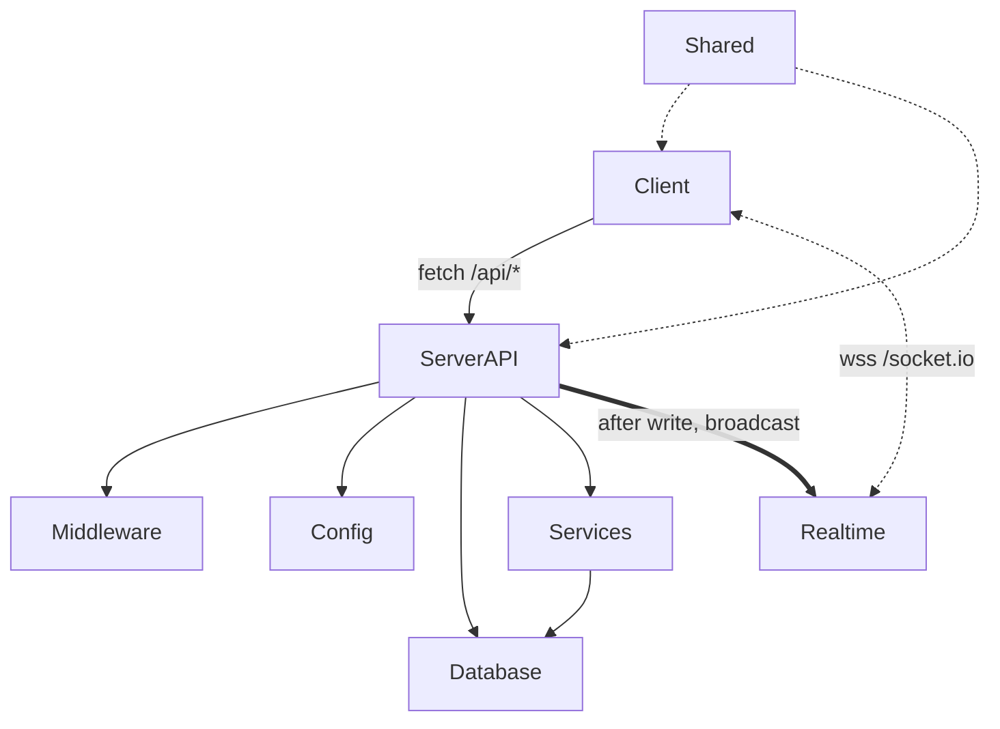

## 1. Stack
- TypeScript throughout, npm workspaces (`shared`, `server`, `client`), Node >=20 (package.json)
- Frontend: React 19, Vite, Tailwind CSS v4, TanStack Query, React Router, `@dnd-kit` (README.md)
- Backend: Node 22, Express 5, Mongoose 8, Socket.IO 4 (README.md)
- Validation: Zod schemas shared by client and server (README.md, shared/src/index.ts)
- Tests: Vitest, Supertest, `mongodb-memory-server` (README.md, server/tests/)

## 2. Directory map
| path | what lives there |
| --- | --- |
| client/ | React SPA (Vite + TS + Tailwind) |
| client/src/ | App.tsx, main.tsx, pages/, features/, components/, lib/ |
| server/ | Express 5 API + Socket.IO + Mongoose, single Node process |
| server/src/ | app.ts, index.ts, config/, middleware/, modules/, realtime/, services/, db/, models/, utils/, types/, devDb.ts, seed.ts |
| server/tests/ | 41 Vitest integration tests (auth, board, cascade, comments, notifications, projects) |
| shared/ | `@pm/shared` — DTOs, Zod schemas, socket event contract, ordering maths |
| shared/src/ | constants.ts, events.ts, position.ts, schemas.ts, types.ts, index.ts |
| obsidian-vault/ | pre-existing Obsidian notes about this project (out of scope for this task) |

## 3. Diagram

## 4. Component index
- [[Client]]
- [[Shared]]
- [[ServerAPI]]
- [[Middleware]]
- [[Config]]
- [[Realtime]]
- [[Services]]
- [[Database]]

## 5. Entry points
- **Dev**: `npm run dev` (root) runs concurrently: `server/src/devDb.ts` (local mongod), `tsc -p shared/tsconfig.json --watch`, `tsx watch server/src/index.ts` (API on port 4000), `vite --config client/vite.config.ts` (client on port 5173, proxies `/api` and `/socket.io`) — package.json
- **Prod**: `npm run build` (shared → server → client) then `npm start` → `node server/dist/index.js`, one process serving API + Socket.IO + built SPA on `env.PORT` — package.json, server/src/index.ts, server/src/app.ts
- Client entry: `client/src/main.tsx` renders `client/src/App.tsx`
- Server entry: `server/src/index.ts` calls `createApp()` from `server/src/app.ts`

## 6. Conventions
- Relative imports in server TS source use explicit `.js` extensions (e.g. `from './app.js'`, `from './config/env.js'`) — server/src/index.ts, server/src/app.ts
- Root `npm run` scripts call `tsc`/`vite`/`tsx` directly rather than `npm run -w <workspace>`, because a nested workspace `npm run` inside a script silently discards the rest of an `&&` chain — package.json `comments` field
- REST routes are mounted once under `/api` via a single `apiRouter` (server/src/modules/router.ts, imported in server/src/app.ts)
- Centralized error handling: `errorHandler` and `notFoundHandler` from `server/src/middleware/error.js`, `errorHandler` registered last — server/src/app.ts
- Health check exposed at `GET /api/health` before the `/api` router — server/src/app.ts
- Secrets are redacted before logging (`redact()` strips the password from the Mongo URI) — server/src/index.ts
- Helmet CSP is enabled only in production (`env.isProd`); disabled in dev because Vite serves the client from its own origin — server/src/app.ts
- Production static serving is conditional on the client build existing (`fs.existsSync(env.clientDist)`) with an SPA fallback route — server/src/app.ts
- Graceful shutdown on `SIGINT`/`SIGTERM`: realtime shutdown → HTTP server close → DB disconnect, in that order — server/src/index.ts

## 7. Where things go
- New REST endpoint: add a module under `server/src/modules/`, register it on `apiRouter` (server/src/modules/router.ts), add its Zod schema to `shared/src/schemas.ts` if client and server both validate it
- New socket event: type it in `shared/src/events.ts` (`ServerToClientEvents`/`ClientToServerEvents`), broadcast it from `server/src/realtime/emit.ts`, handle it in `server/src/realtime/io.ts`
- New client page: add a file under `client/src/pages/`, wire a `<Route>` in `client/src/App.tsx`
- New shared DTO/type: add to `shared/src/types.ts`, export via `shared/src/index.ts` so both client and server pick it up
- New environment variable: add to `server/src/config/env.ts` (Zod-validated at boot) and document it in `.env.example`
