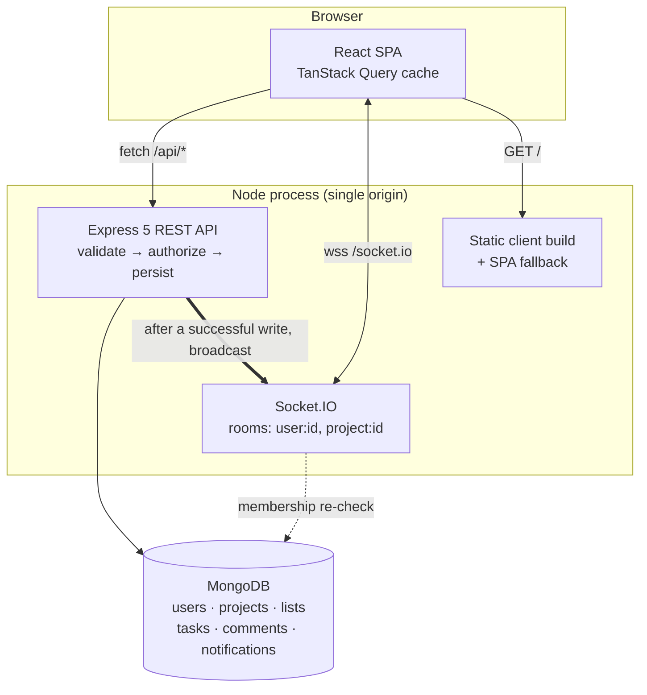

# Kanvas — Collaborative Project Management Tool

A full-stack Trello/Asana-style project management tool: shared boards, drag-and-drop task
cards, per-task discussion, and live updates over WebSockets so everyone looking at a board
sees the same thing at the same moment.

Built as a CodeAlpha internship task (`CodeAlpha_ProjectManagementTool`).

**Demo account** — `demo@example.com` / `Demo1234`

---

## What it does

**Accounts** — Email/password sign-up and sign-in. Passwords are bcrypt-hashed (cost 12) and
the session is a JWT in an `httpOnly` cookie, so no token is ever readable from JavaScript.

**Group projects** — Create a project, add teammates by email, and manage them as
`owner` / `admin` / `member`. Rank rules are enforced server-side: you can only act on someone
you outrank, the owner can't be removed or demoted, and any member can leave on their own.

**Boards** — Each project is a board of user-defined columns. Drag cards within a column or
across columns; drag columns to reorder the board. Moves are optimistic and roll back if the
server rejects them.

**Task cards** — Title, description, multiple assignees, due date (overdue and due-today are
colour-coded), priority, and labels. Cards are deep-linkable: `/projects/:id?task=:taskId`
opens straight into one.

**Discussion** — A comment thread per card, with edit and delete. Authors edit their own
comments; admins can remove any.

**Notifications** — An in-app bell with an unread badge, raised when you're assigned a card,
when someone comments on a card you created or are assigned to, and when you're added to a
project or your role changes. You are never notified about your own actions.

**Live updates** — Every change broadcasts to everyone viewing that project: cards appear,
move, and change as others edit them, comment threads update in place, and the header shows
how many people are on the board. A connection indicator says plainly when updates have
stopped arriving, and a dropped connection resyncs on reconnect.

---

## Stack

| Layer | Choice |
| --- | --- |
| Frontend | React 19, Vite, TypeScript, Tailwind CSS v4, TanStack Query, React Router |
| Drag & drop | `@dnd-kit` |
| Backend | Node 22, Express 5, TypeScript, Mongoose 8 |
| Database | MongoDB |
| Real-time | Socket.IO 4 |
| Validation | Zod schemas shared by client and server |
| Tests | Vitest, Supertest, `mongodb-memory-server` |

---

## Architecture

One Node process serves the REST API, the Socket.IO endpoint, and the built React app. Because
everything is same-origin there is no CORS configuration, and the auth cookie is first-party.



### One rule holds the design together

**Clients never mutate over the WebSocket.** Every write is a REST call that validates,
authorizes, persists, and only then broadcasts. Authorization therefore exists in exactly one
place instead of being duplicated — and drifting — across two transports. Sockets are
broadcast-only.

### Card ordering

Cards carry a float `position` and a move writes the **midpoint of its neighbours**, so one
drag updates exactly one document and cannot disturb anyone else's card. Positions are always
computed on the server from the neighbours' *current* positions — a move request sends
neighbour **ids**, never a position — so a stale board can't write a colliding value.

Repeated midpoints halve the gap, so after ~25 drops into the same slot floats run out of
room. When the gap falls below a threshold the column is rewritten to clean multiples
(1000, 2000, 3000…) and the new positions are broadcast. `calcPosition` lives in the shared
package so the client predicts the same result for its optimistic update and the card doesn't
twitch when the response lands.

### Echoes

The tab that makes a change has already applied it optimistically, so it sends its socket id
in an `x-socket-id` header and the server broadcasts with `.except(socketId)`. Without this the
originator applies its own change twice and cards visibly jump.

---

## Running it locally

Requires Node 20+. **No database setup needed** — with `MONGODB_URI` unset, `npm run dev`
starts a real local `mongod` (downloaded and cached on first run) on port 27018 and persists
data to `.data/mongo`.

```bash
npm install
npm run dev
```

Then open http://localhost:5173. Vite proxies `/api` and `/socket.io` to the API on port 4000,
so cookies stay first-party in development too.

Load the sample board and demo account:

```bash
npm run seed
```

### Scripts

| Command | Does |
| --- | --- |
| `npm run dev` | Database, shared-types watcher, API, and client together |
| `npm run seed` | Wipes and repopulates with the demo data (refuses production without `--force`) |
| `npm test` | Integration suite against a throwaway in-memory MongoDB |
| `npm run typecheck` | Typechecks all three packages |
| `npm run build` | Builds shared → server → client for production |
| `npm start` | Runs the production build (serves API + SPA on one port) |
| `npm run db:dev` | Just the local development database |

Prefer your own MongoDB or Atlas? Set `MONGODB_URI` and the managed database step is skipped.

---

## Configuration

Copy `.env.example` to `.env`. Everything has a safe default in development; production
validates at boot and **refuses to start** if something required is missing.

| Variable | Required | Default | Notes |
| --- | --- | --- | --- |
| `MONGODB_URI` | in production | local managed `mongod` | Connection string |
| `JWT_SECRET` | in production | dev-only fallback (warns loudly) | Must be ≥ 32 characters |
| `PORT` | no | `4000` | |
| `NODE_ENV` | no | `development` | `production` enables `Secure` cookies, CSP and HSTS |
| `JWT_EXPIRES_IN` | no | `7d` | Also drives the cookie's lifetime |
| `COOKIE_NAME` | no | `pm_token` | |

---

## Deploying

The build produces one deployable process, so any Node host works (Render, Railway, Fly, a VPS).

- **Build command** — `npm install && npm run build`
- **Start command** — `npm start`
- **Environment** — `NODE_ENV=production`, `MONGODB_URI` (e.g. MongoDB Atlas), `JWT_SECRET` (≥32 chars)

Two things worth knowing:

- WebSockets need a **long-lived process**. Serverless platforms that recycle per request
  (e.g. Vercel functions) can't hold the connection — deploy the Node service as a service.
- Free tiers usually **sleep when idle**, so the first visit after a quiet spell can take
  ~50 seconds. Point an uptime pinger at `/api/health` if a reviewer will be clicking the link
  cold.

---

## Project layout

```
shared/     @pm/shared — DTOs, Zod schemas, socket event contract, ordering maths
  src/schemas.ts     one set of validators used by Express AND the React forms
  src/events.ts      typed ServerToClientEvents / ClientToServerEvents
  src/position.ts    calcPosition / needsRenormalize, used by both sides

server/
  src/config/env.ts          Zod-validated environment, fails at boot not at runtime
  src/middleware/            requireAuth · requireProjectRole · validate · errorHandler
  src/modules/               auth · users · projects · lists · tasks · comments · notifications
  src/realtime/io.ts         handshake auth, room membership, presence
  src/realtime/emit.ts       typed broadcast helpers with echo suppression
  src/services/notify.ts     notification triggers
  src/services/cascade.ts    manual cascade deletes (MongoDB has no foreign keys)
  src/utils/position.ts      renormalization
  src/devDb.ts               the local development mongod
  tests/                     41 integration tests

client/
  src/features/board/        board, columns, cards, dnd orchestration, cache helpers
  src/features/task/         card detail dialog and comment thread
  src/features/realtime/     socket subscription and cache patching
  src/features/notifications/
  src/lib/api.ts             fetch wrapper, sends x-socket-id on mutations
```

---

## Security notes

- Passwords bcrypt-hashed at cost 12; `passwordHash` is `select: false` **and** stripped in
  `toJSON`, so no route can leak it by accident.
- Login answers identically for a wrong password and an unknown account, so it can't be used
  to enumerate who has an account.
- **Non-members get `404`, not `403`,** on a project they can't see — a `403` would confirm the
  project exists to anyone guessing ids.
- Socket connections authenticate at the handshake from the same cookie, and joining a project
  room re-checks membership against the database: a socket id is not authorization.
- Assignees must be members of the task's project, so work can't be assigned to strangers.
- Zod validation on every request body; Helmet for CSP/HSTS; rate limiting on the credential
  endpoints.

---

## Tests

```bash
npm test
```

41 integration tests over a throwaway in-memory MongoDB — no running database required. They
cover the session cookie round trip, account enumeration resistance, the full role matrix
(including that an admin can't touch the owner or a fellow admin), midpoint ordering, the
renormalization path, cross-project drag rejection, assignee membership, comment permissions,
notification triggers and self-notification suppression, and every cascade delete.

CI (`.github/workflows/ci.yml`) runs typecheck, tests, and a production build on every push
and pull request.

---

## Known limitations

Deliberate scope choices, not oversights:

- **No email delivery**, so no email verification, no password reset, and no invite links —
  teammates are added by looking up an existing account by email.
- **One 7-day access token**, no refresh-token rotation. Logout clears the cookie server-side.
- No file attachments, checklists, subtasks, or time tracking.
- Comment threads are unpaginated, and the notification list is capped at the newest 50.
- Notifications are in-app only. Due-date reminders would need a scheduler, which a
  sleeping free-tier host can't be relied on to run.
- Cascade deletes are sequential rather than transactional: transactions need a replica set,
  which the local development database isn't, and having development take a different code path
  from production would be worse than the failure mode being guarded against. Children are
  deleted before parents, so an interrupted delete can only leave unreachable orphans, never a
  dangling reference that breaks a read.
