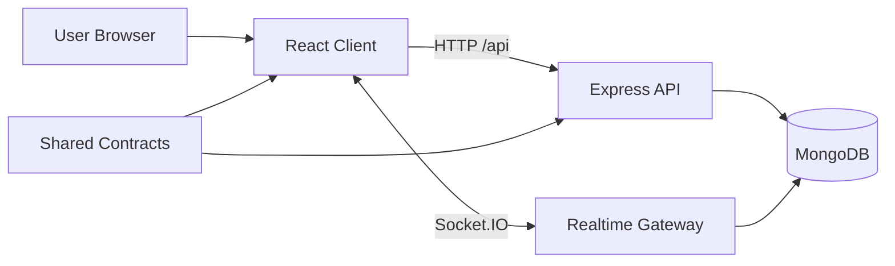

# System Overview

## Purpose
A collaborative project management application with:
- Authenticated users
- Projects with role-based access
- Board/list/task management with drag-and-drop
- Per-task comments
- In-app notifications
- Realtime board and presence updates

## Monorepo Layout
- `shared`: cross-package contracts and pure utilities
- `server`: REST API + websocket server + static hosting for the built client
- `client`: React SPA with query cache, routing, and realtime subscriptions

## Architectural Principles
1. All mutations go through REST. Websocket is broadcast-only.
2. Authorization is checked server-side for every protected action.
3. Shared schemas and event contracts reduce drift between client and server.
4. Optimistic UI is used for fluid interactions, then reconciled with server truth.

## High-Level Context

Related: [[03 Runtime Architecture]], [[05 Request and Realtime Flows]], [[06 Engineering Plan]]
