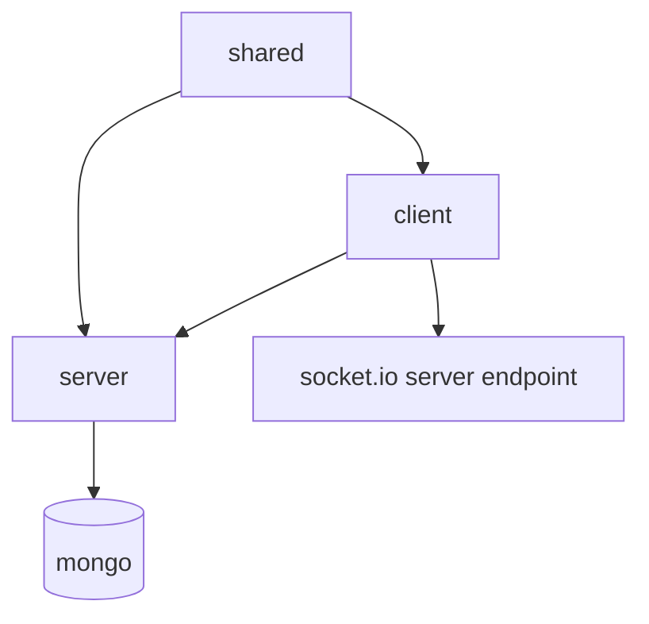

# Folder Structure Map

## Root
- `package.json`: workspace scripts for dev/build/test/typecheck
- `README.md`: functional and architecture documentation
- `client/`: frontend app
- `server/`: backend app
- `shared/`: shared DTOs/schemas/events/position logic

## Client (`client/src`)
- `components/`: reusable UI building blocks and shell components
- `features/auth/`: auth layout, route guards, auth hooks
- `features/board/`: board canvas, columns, cards, drag and cache helpers
- `features/task/`: task dialog and comment thread
- `features/notifications/`: bell and notification hooks
- `features/realtime/`: socket connection and board realtime subscriptions
- `lib/`: API wrapper, query client, socket utilities
- `pages/`: route-level screens

## Server (`server/src`)
- `app.ts`: express middleware setup, health endpoint, static SPA serving
- `index.ts`: process bootstrap, DB connect, HTTP + realtime startup
- `config/`: environment schema and runtime config
- `db/`: DB connection setup
- `middleware/`: auth, validation, access checks, centralized error handling
- `models/`: Mongoose collections (User, Project, List, Task, Comment, Notification)
- `modules/`: route modules per domain
- `realtime/`: socket server, room orchestration, typed emits
- `services/`: cross-module domain services (cascade, notify)
- `utils/`: helpers (token, ordering/position, serialization)

## Shared (`shared/src`)
- `schemas.ts`: Zod request/DTO contracts
- `events.ts`: typed socket event contracts
- `position.ts`: ordering helpers used on both client and server
- `types.ts` and `constants.ts`: shared domain types/constants

## Dependency Direction

Related: [[01 System Overview]], [[03 Runtime Architecture]]
