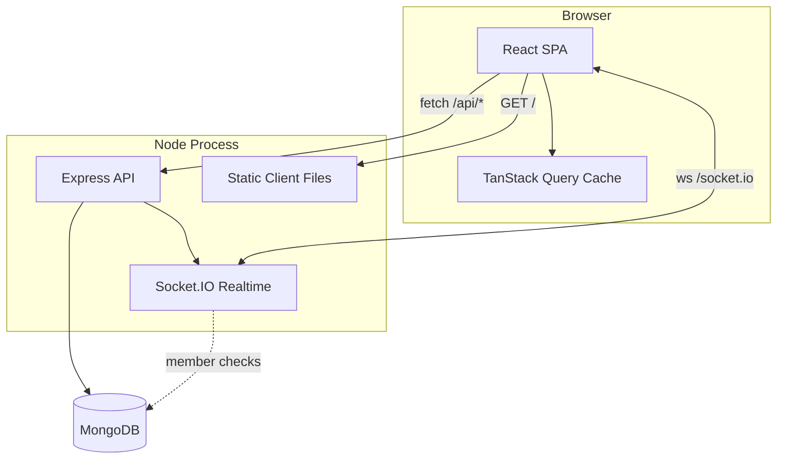
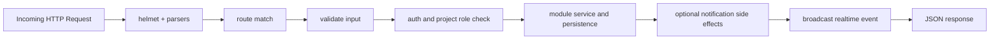

# Runtime Architecture

## Boot Sequence
1. Server starts and validates environment config.
2. Database connection is established.
3. Express app is created with middleware stack.
4. HTTP server starts listening.
5. Socket.IO attaches to the same HTTP server.
6. Client (in dev via Vite, in prod via static build) loads and authenticates.

## Deployment Shape
Single Node process serves:
- REST API under `/api`
- Socket.IO endpoint under `/socket.io`
- Static SPA assets in production

## Component Diagram

## Request Handling Pipeline

Related: [[05 Request and Realtime Flows]], [[04 Domain Model]]
