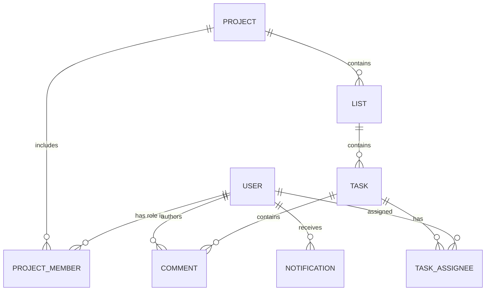

# Domain Model

## Core Entities
- User: account identity, credentials, profile
- Project: collaboration boundary and membership roles
- List: ordered container inside a project board
- Task: actionable item with assignees, due date, labels, priority
- Comment: threaded discussion entry for one task
- Notification: user-facing event feed item

## Ownership and Access
- Project membership controls visibility and edit rights.
- Role hierarchy controls admin actions.
- Non-members are treated as resource-not-found for project access.

## Relationship Diagram

## Ordering Strategy
- Lists and tasks use position values.
- Reorder operations compute midpoint positions.
- Server can renormalize dense positions to keep ordering stable.

Related: [[03 Runtime Architecture]], [[06 Engineering Plan]]
