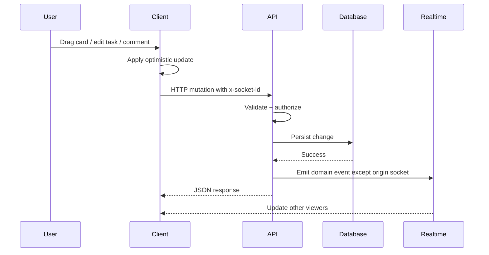
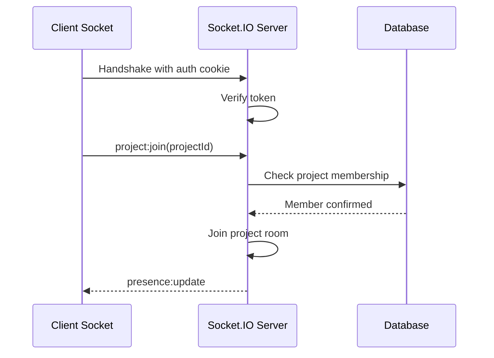

# Request and Realtime Flows

## Mutation Flow (Authoritative)

## Realtime Presence Flow

## Why This Pattern Works
1. Single write path avoids duplicated authorization logic.
2. Optimistic UX remains fast while server keeps canonical state.
3. Shared contracts reduce client/server mismatch errors.

Related: [[01 System Overview]], [[03 Runtime Architecture]]
